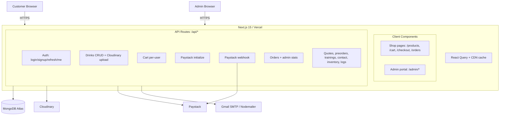
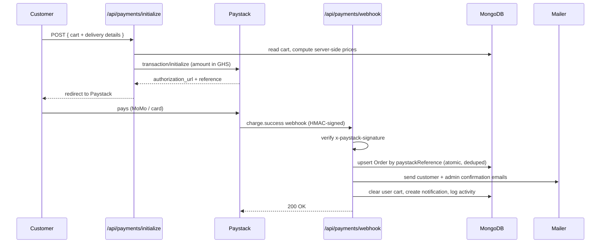

# Duks Juice

> E-commerce platform for cold-pressed juices, smoothies, wellness shots, cut fruits, and gift packs — serving Accra, Ghana.

Duks Juice is a full-stack e-commerce application built with **Next.js 15 (App Router)**, **MongoDB**, **Paystack** payments, and a full admin dashboard. Customers can browse products by category, add to cart, check out with mobile money / card payments, and track their orders. Administrators manage products (with Cloudinary image upload), orders, customers, payments, analytics, users, inventory, quotes, and activity logs from a dedicated admin portal.

---

## Table of Contents

- [Features](#features)
- [Tech Stack](#tech-stack)
- [Architecture](#architecture)
- [Project Structure](#project-structure)
- [Data Models](#data-models)
- [Authentication & Authorization](#authentication--authorization)
- [Key Flows](#key-flows)
- [API Reference](#api-reference)
- [Caching Strategy](#caching-strategy)
- [Getting Started](#getting-started)
- [Environment Variables](#environment-variables)
- [Available Scripts](#available-scripts)
- [Testing](#testing)
- [Deployment](#deployment)
- [Production Operations](#production-operations)
- [Troubleshooting](#troubleshooting)
- [Security & Known Limitations](#security--known-limitations)
- [Contributing](#contributing)
- [License](#license)

---

## Features

**Storefront (`/` shop pages)**
- Category-driven product browsing (`/products`, `/products/[category]`) with responsive grid, lazy-loading ("Load more"), and tab navigation.
- Products are always listed **newest-first** within every category.
- Multi-pack pricing (e.g. 6-pack, 12-pack) with optional "was" (old price) discount display.
- Cart with guest + logged-in persistence, pack selection, quantity updates, and merge-on-login.
- Paystack checkout (mobile money & card) in Ghana Cedis (GHS).
- Order tracking (`/orders`), order cancellation, and payment-success page.
- Bulk order quote form (`/bulk-quote`), contact page, and training page.
- SEO: metadata, Open Graph/Twitter cards, JSON-LD structured data (Organization, WebSite, FoodEstablishment, BreadcrumbList), and a generated `sitemap.xml`.

**Admin portal (`/admin/*`)**
- Dashboard (KPIs, revenue trend, recent orders, category stats).
- Product management: create/edit/delete with **Cloudinary image upload**, pack pricing, and status toggles.
- Orders: list, detail, status updates, cancellation, batch delete, payment records.
- Customers, payments, revenue trend, and analytics.
- User management (create, list, delete, batch delete, promote).
- Inventory management with stock alerts.
- Activity log, in-app notifications, and settings.

**Platform**
- JWT access + refresh token authentication with fixed admin bootstrap accounts.
- Server-side price calculation and webhook-verified payment confirmation.
- Order confirmation emails to customers + admins via Nodemailer (Gmail SMTP).
- Activity logging and admin notification feed.
- Automated tests (Jest + in-memory MongoDB).

---

## Tech Stack

| Layer | Technology |
|---|---|
| Framework | [Next.js 15.5](https://nextjs.org) (App Router, React 18, TypeScript 5.8) |
| Styling | [Tailwind CSS 3.4](https://tailwindcss.com) + [shadcn/ui](https://ui.shadcn.com) (Radix UI primitives) + Framer Motion |
| Database | [MongoDB Atlas](https://www.mongodb.com/atlas) + [Mongoose 8](https://mongoosejs.com) |
| Auth | JWT (`jsonwebtoken`) access + refresh tokens, `bcryptjs` password hashing |
| Payments | [Paystack](https://paystack.com) (initialization + HMAC-verified webhook) |
| Media | [Cloudinary](https://cloudinary.com) (product image upload) |
| Email | [Nodemailer](https://nodemailer.com) (Gmail SMTP) |
| State | [Zustand](https://zustand.docs.pmnd.rs) (client/cart) + [TanStack Query](https://tanstack.com/query) (server state) |
| HTTP | [Axios](https://axios-http.com) |
| Testing | [Jest](https://jestjs.io) + `ts-jest` + `mongodb-memory-server` |
| Deployment | [Vercel](https://vercel.com) |

---

## Architecture

The application is a **Next.js App Router monolith** (frontend + API routes served from the same deployment). Server-side API routes (`src/app/api/**`) handle data access, auth, and payments; client components fetch via an Axios wrapper.



### Request flow — checkout (example)



---

## Project Structure

```
.
├── __tests__/                  # Jest tests + in-memory Mongo setup
│   ├── globalSetup.ts          # Boots mongodb-memory-server
│   ├── setup.ts                # Injects test env vars + MONGODB_URI
│   ├── helpers.ts              # Test users/admins/drinks + token helpers
│   └── api/                    # auth, cart, drinks, drinks-add tests
├── public/                     # Static assets (images, logos, favicon)
├── src/
│   ├── app/                    # App Router: pages + API routes
│   │   ├── (shop)/             # Public storefront route group
│   │   │   ├── auth/           #   Login / sign up
│   │   │   ├── products/       #   Product listing + category tabs
│   │   │   ├── cart/           #   Cart page
│   │   │   ├── checkout/       #   Checkout page
│   │   │   ├── orders/         #   My orders
│   │   │   ├── payment-success/
│   │   │   ├── bulk-quote/     #   Bulk order quote form
│   │   │   ├── contact/        #   Contact page
│   │   │   ├── training/       #   Training page
│   │   │   └── csr/
│   │   ├── admin/              # Admin portal (dashboard, orders, products…)
│   │   ├── api/                # All API route handlers (see API Reference)
│   │   ├── layout.tsx          # Root layout (fonts, SEO, JSON-LD, Providers)
│   │   ├── sitemap.ts          # Generated XML sitemap
│   │   └── globals.css
│   ├── admin/                  # Admin UI components & pages
│   │   ├── components/         #   AdminLayout, DataTable, charts, dropdowns
│   │   └── pages/              #   Dashboard, Orders, Products, Customers…
│   ├── api/                    # Client-side Axios helpers (authApi, products…)
│   ├── assets/
│   ├── components/             # Shared UI (shadcn/ui + custom: Header, Footer…)
│   ├── context/                # React context (AuthContext)
│   ├── hooks/
│   ├── lib/                    # Server utilities
│   │   ├── mongodb.ts          #   Cached Mongoose connection
│   │   ├── auth.ts             #   JWT sign/verify (access + refresh)
│   │   ├── cloudinary.ts       #   Cloudinary upload helper
│   │   ├── email.ts            #   Nodemailer transporter
│   │   ├── notifier.ts         #   Admin notifications
│   │   ├── activityLogger.ts   #   Activity log writer
│   │   └── utils.ts            #   `cn()` class-merge helper
│   ├── models/                 # Mongoose models
│   ├── store/                  # Zustand store (cartStore)
│   └── views/                  # Client page views (Products, Home, …)
├── middleware.ts*              # Cache-Control headers per route
├── next.config.ts              # Headers, image remote patterns, build flags
├── tailwind.config.ts          # Theme tokens + fonts
├── jest.config.ts              # Jest + ts-jest + in-memory Mongo
├── vercel.json                 # Vercel framework preset
└── package.json
```

\* Note: `src/middleware.ts` applies cache headers; it does **not** gate access. All authorization happens inside API route handlers.

### Module aliases

`@/*` maps to `./src/*` (see `tsconfig.json`). Both Jest (`moduleNameMapper`) and Next.js honor this alias.

---

## Data Models

All models live in `src/models/` and use Mongoose with timestamps.

| Model | Purpose | Key fields |
|---|---|---|
| `User` | Customer / admin accounts | `username`, `email` (unique), `passwordHash`, `isAdmin`, `lastLogin` |
| `Drink` | Product | `name`, `description`, `category`, `size`, `status` (`active`/`inactive`/`few packs left`/`out of stock`), `available`, `imageUrl`, `packs[]` (`pack`, `price`, `oldPrice`) |
| `Cart` | Per-user cart line | `userId`, `drinkId`, `quantity`, `pack` (unique `userId + drinkId + pack`) |
| `Order` | Placed order | `userId`, `customer`, `items[]`, `deliveryDate`, `deliveryTime`, `totalAmount`, `paystackReference` (unique), `paymentStatus` (`pending`/`paid`/`refunded`), `orderStatus` (`pending`→`completed`), `orderNumber`, `vendor` |
| `Quote` | Bulk quote requests | `company`, `email`, `phone`, `quantity`, `product`, `estimatedTotal`, `notes`, `status` (`pending`/`approved`/`converted`/`denied`) |
| `Preorder` | Pre-orders | via `/api/preorders` |
| `Training` | Training courses | `name`, `description`, `price`, `duration`, `format` (`In-person`/`Online`/`Hybrid`), `category`, `status`, `maxParticipants`, `currentParticipants`, `imageUrl` |
| `TrainingRegistration` | Training sign-ups | via `/api/trainings` |
| `Inventory` | Stock tracking | `product`, `sku` (unique), `stock`, `reorderPoint`, `supplier`, `unit` |
| `Notification` | Admin notification feed | `type` (`new_order`/`new_contact`/`new_user`/`order_status`/`system`), `title`, `message`, `link`, `metadata` |
| `ActivityLog` | Audit trail | `user`, `email`, `action`, `details`, `metadata`, `ip` |

---

## Authentication & Authorization

**Token model:** JSON Web Tokens — a short-lived **access token** (`JWT_SECRET`, default `15m`) and a long-lived **refresh token** (`REFRESH_SECRET`, default `7d`).

**Flow:**
1. `POST /api/auth/login` validates credentials, returns `{ token, refreshToken, role, user }`.
2. The client stores the pair in `localStorage` (remember me) or `sessionStorage` (session-only) under the `user` key.
3. The Axios instance (`src/api/axios.ts`) attaches `Authorization: Bearer <token>` to every request and redirects to `/auth` on a `401`.
4. `POST /api/auth/refresh` exchanges a refresh token for a new access token.
5. Server-side, `verifyAuth(req)` (in `src/lib/auth.ts`) decodes the Bearer token. Admin-only routes additionally check `authUser.isAdmin`.

**Admin bootstrap:** Login credentials are seeded from environment variables (`ADMIN_EMAIL_1…3` + `ADMIN_PASSWORD_1…3`). The first time a matching credential logs in, a `User` document with `isAdmin: true` is auto-created (and a non-admin user with a matching email is promoted).

> **Note:** Clients keep tokens in `localStorage`/`sessionStorage` (not HTTP-only cookies). This is simpler to deploy and matches the current architecture, but means tokens are readable by XSS — see [Security & Known Limitations](#security--known-limitations).

---

## Key Flows

### Product creation (with image upload)
1. Admin fills the product form; the client builds `FormData` (`name`, `category`, `description`, `size`, `status`, `packs` as a JSON string, optional `image` file).
2. `POST /api/drinks/add` reads the multipart body, validates packs/status, uploads the image to Cloudinary, and stores the returned `secure_url` as `imageUrl`.
3. The API returns the created drink; the admin grid prepends it so it appears **first in its category** immediately. The store page reflects the new ordering via `GET /api/drinks` (sorted by `createdAt` descending).

### Cart lifecycle
- Guests: cart lives in `localStorage` via Zustand (`src/store/cartStore.ts`), items prefixed `local-`.
- Logged-in: cart lines persist in the `Cart` collection keyed by `userId`.
- On login, guest items are merged into the user cart (`mergeGuestIntoUser`); on logout, the store switches back to a guest cart.
- "Add to cart while logged out" queues a `pendingAdd` item in `localStorage` and completes it after login/refresh.

### Payments
1. `POST /api/payments/initialize` — validates delivery details, loads the cart, recomputes **server-side** prices, and creates a Paystack transaction with full metadata. Returns `authorization_url`.
2. Customer pays on Paystack (GHS).
3. `POST /api/payments/webhook` — verifies the `x-paystack-signature` (HMAC-SHA512 of the raw body using `PAYSTACK_SECRET_KEY`), then for `charge.success` upserts the `Order` by `paystackReference` (atomic + idempotent), sends emails, creates a notification, logs activity, and clears the cart.

### Notifications & activity
- `src/lib/notifier.ts` → `Notification` collection (shown in the admin header dropdown).
- `src/lib/activityLogger.ts` → `ActivityLog` collection (admin logs are skipped).

---

## API Reference

All endpoints live under `/api`. Admin endpoints require a valid admin Bearer token.

### Auth
| Method | Path | Auth | Description |
|---|---|---|---|
| POST | `/api/auth/signup` | – | Create a user account |
| POST | `/api/auth/login` | – | Log in (also bootstraps fixed admins) |
| POST | `/api/auth/refresh` | – | Exchange refresh token for a new access token |
| POST | `/api/auth/logout` | – | Invalidate session |
| GET | `/api/auth/me` | User | Current user info |
| GET | `/api/auth/users` | Admin | List users |
| POST | `/api/auth/users` | Admin | Create user |
| POST | `/api/auth/users/batch-delete` | Admin | Delete multiple users |
| GET | `/api/auth/users/count` | Admin | Total user count |
| DELETE | `/api/auth/users/[id]` | Admin | Delete a user |

### Drinks / Products
| Method | Path | Auth | Description |
|---|---|---|---|
| GET | `/api/drinks` | – | List all drinks, **newest first** (`createdAt` desc) |
| POST | `/api/drinks` | Admin | Create drink (**JSON** body — legacy endpoint) |
| POST | `/api/drinks/add` | Admin | Create drink (**multipart form data** + optional Cloudinary image) |
| GET | `/api/drinks/[id]` | – | Get one drink |
| PUT | `/api/drinks/[id]` | Admin | Update drink (**multipart form data**, optional new image) |
| DELETE | `/api/drinks/[id]` | Admin | Delete drink |
| GET | `/api/drinks/stats/category` | – | Drinks per category (used by dashboard/analytics) |

> `POST /api/drinks/add` and `PUT /api/drinks/[id]` expect `packs` as a **JSON string** field, e.g. `packs = '[{"pack":6,"price":15,"oldPrice":null}]'`. Bad packs/status values return `400`, not `500`.

### Cart
| Method | Path | Auth | Description |
|---|---|---|---|
| GET/POST/DELETE | `/api/cart` | User | Get / add / clear cart |
| PUT/DELETE | `/api/cart/[id]` | User | Update / remove a cart line |
| PATCH | `/api/cart/[id]/quantity` | User | Change quantity |
| PATCH | `/api/cart/[id]/pack` | User | Change selected pack |

### Orders
| Method | Path | Auth | Description |
|---|---|---|---|
| GET | `/api/orders` | User | Current user's orders |
| POST | `/api/orders` | – | Create COD order (pay-on-delivery, no Paystack reference) |
| GET | `/api/orders/[id]` | User (owner) / Admin | Order detail |
| PATCH | `/api/orders/[id]` | Admin | Update order status |
| DELETE | `/api/orders/[id]` | Admin | Delete an order |
| POST | `/api/orders/[id]/cancel` | User | Cancel order |
| GET | `/api/orders/customers` | Admin | Order customers |
| GET | `/api/orders/payments` | Admin | Payment records |
| GET | `/api/orders/stats` | Admin | Order statistics |
| GET | `/api/orders/revenue-trend` | Admin | Revenue over time |
| GET | `/api/orders/admin/all` | Admin | All orders |
| DELETE | `/api/orders/admin/[id]` | Admin | Delete an order |
| POST | `/api/orders/admin/batch-delete` | Admin | Batch delete |
| GET | `/api/orders/admin/customers` | Admin | Customer list |
| DELETE | `/api/orders/admin/customer/[email]` | Admin | Delete customer by email |
| POST | `/api/orders/admin/customer/batch-delete` | Admin | Batch delete customers |
| GET | `/api/orders/admin/payments` | Admin | Payment details |
| GET | `/api/orders/admin/stats` | Admin | Dashboard KPIs |
| GET | `/api/orders/admin/revenue-trend` | Admin | Dashboard trend |

### Payments
| Method | Path | Auth | Description |
|---|---|---|---|
| POST | `/api/payments/initialize` | User | Create Paystack transaction from cart |
| POST | `/api/payments/webhook` | Paystack | `charge.success` handler (HMAC-verified) |

### Misc
| Method | Path | Auth | Description |
|---|---|---|---|
| GET | `/api/customers` | Admin | Customer list |
| GET | `/api/dashboard` | Admin | Dashboard data |
| POST | `/api/contact` | – | Contact form |
| GET/POST | `/api/preorders` | – | List / create pre-orders |
| PATCH/DELETE | `/api/preorders` | Admin | Set status / delete pre-orders |
| GET/POST | `/api/quotes` | – | List / submit bulk quote requests |
| PATCH/DELETE | `/api/quotes` | Admin | Set status / delete quotes |
| GET | `/api/trainings` | – | List trainings |
| POST | `/api/trainings` | Admin | Create training |
| GET | `/api/trainings/[id]` | – | Training detail |
| PUT/DELETE | `/api/trainings/[id]` | Admin | Update / delete training |
| GET | `/api/inventory` | – | List inventory (admin data — should be locked to admin) |
| POST | `/api/inventory` | Admin | Create inventory item |
| PUT/DELETE | `/api/inventory/[id]` | Admin | Update / delete inventory item |
| GET | `/api/inventory/alerts` | – | Low-stock alerts (admin data — should be locked to admin) |
| GET | `/api/activity-logs` | Admin | Activity logs |
| GET | `/api/activity-logs/actions` | Admin | Log actions |
| GET | `/api/activity-logs/stats` | Admin | Log statistics |
| GET/PATCH/DELETE | `/api/notifications` | Admin | List / update / delete notifications |
| PATCH | `/api/notifications/read-all` | Admin | Mark all read |

> Some legacy admin endpoints (e.g. `/api/customers`, `/api/inventory`) currently return `500` (not `401`) when the token is missing/invalid because their `verifyAuth` error is swallowed by the catch block. Only the drinks endpoints return a proper `401` today. Fixing this consistently is a recommended follow-up — see [Security & Known Limitations](#security--known-limitations).

> A few admin-data `GET` endpoints (`/api/inventory`, `/api/inventory/alerts`, `/api/preorders`, `/api/quotes`, `/api/trainings`) have **no auth check** and are publicly readable. They should be locked to admin — see [Security & Known Limitations](#security--known-limitations).

---

## Caching Strategy

Caching is controlled in three places:

1. **`next.config.ts` → `async headers()`**
   - All HTML/API routes (excluding `_next/static`, `images/`, `favicon.ico`): `public, max-age=0, must-revalidate`.
   - `/images/*`: `public, max-age=31536000, immutable`.
   - `/api/drinks`: `public, s-maxage=300, stale-while-revalidate=600` — the product list is **CDN-cached for up to 5 minutes**.

2. **`src/middleware.ts`**
   - `/admin`, `/auth`, `/cart`, `/checkout`, `/orders`: `private, no-cache, no-store`.
   - `/api/*`: `private, no-cache`.

3. **Client**
   - TanStack Query provider default `staleTime: 60s`.
   - The store product page overrides `staleTime: 5min` (`src/views/Products.tsx`).

> Because of the CDN cache + client `staleTime`, a newly created product may take up to ~5 minutes to appear on the public store page. The admin dashboard always reflects new products immediately (no cache, and new products are prepended client-side).

---

## Getting Started

### Prerequisites

- **Node.js ≥ 20** (LTS) and **npm**.
- A **MongoDB** database (Atlas is used in production; local `mongod` works too).
- Accounts/keys for: **Cloudinary** (images), **Paystack** (payments), **Gmail SMTP** (email) — optional for local dev until you test those features.
- **Python** is required by `mongodb-memory-server` only if you run the test suite without a pre-downloaded binary.

### Installation

```bash
# 1. Clone & install
git clone <repo-url> durks
cd durks
npm install

# 2. Create environment file
cp .env.example .env.local   # create from the table below

# 3. Run the dev server
npm run dev
```

Open [http://localhost:3000](http://localhost:3000).

> There is currently **no committed `.env.example`** — create `.env.local` from the [Environment Variables](#environment-variables) table below. Never commit `.env.local` (it is gitignored).

---

## Environment Variables

| Variable | Required | Description |
|---|---|---|
| `MONGODB_URI` | ✅ | MongoDB connection string |
| `JWT_SECRET` | ✅ | Secret for access tokens |
| `REFRESH_SECRET` | ✅ | Secret for refresh tokens |
| `ACCESS_EXPIRES` | | Access token lifetime (default `15m`) |
| `REFRESH_EXPIRES` | | Refresh token lifetime (default `7d`) |
| `ADMIN_EMAIL_1`, `ADMIN_PASSWORD_1` | ✅* | Fixed admin #1 (bootstrapped on first login) |
| `ADMIN_EMAIL_2`, `ADMIN_PASSWORD_2` | | Fixed admin #2 |
| `ADMIN_EMAIL_3`, `ADMIN_PASSWORD_3` | | Fixed admin #3 |
| `ADMIN_EMAIL` | | Receives new-order notification emails |
| `CLOUDINARY_CLOUD_NAME` | for image upload | Cloudinary cloud name |
| `CLOUDINARY_API_KEY` | for image upload | Cloudinary API key |
| `CLOUDINARY_API_SECRET` | for image upload | Cloudinary API secret |
| `PAYSTACK_PUBLIC_KEY` | for checkout | Paystack public key (client) |
| `PAYSTACK_SECRET_KEY` | for checkout | Paystack secret key (server + webhook HMAC) |
| `FRONTEND_URL` | for checkout | Public site origin — used to build the Paystack `callback_url` (`{FRONTEND_URL}/orders`) |
| `SMTP_USER` | for email | Gmail address used for sending |
| `SMTP_PASS` | for email | Gmail app password (not your account password) |
| `SMTP_HOST` | | SMTP host (default `smtp.gmail.com`) |
| `SMTP_PORT` | | SMTP port (default `587`) |
| `SMTP_SECURE` | | `true`/`false` for TLS |
| `EMAIL_FROM` | | From header for outbound mail |
| `PAYSTACK_CALLBACK_URL` | optional | Present in the repo's `.env.local` but **not currently read by code** (legacy) |
| `COOKIE_DOMAIN` | optional | Present but **not currently read by code** (legacy) |

\* At least one fixed admin is required to access the admin portal.

> **Security:** rotate the `JWT_SECRET`, `REFRESH_SECRET`, and any credentials before going live. The values shipped in `src/__tests__/setup.ts` are for tests only.

---

## Available Scripts

| Script | Description |
|---|---|
| `npm run dev` | Start the Next.js dev server with hot reload |
| `npm run build` | Production build (type/lint checks are skipped via `next.config.ts`) |
| `npm start` | Start the production server (`next start`) |
| `npm run lint` | Run ESLint over the project |
| `npm test` | Run Jest once (`--forceExit`) |
| `npm run test:watch` | Run Jest in watch mode |
| `npm run test:coverage` | Run Jest with coverage (API routes + `src/lib`) |

---

## Testing

Jest is configured (`jest.config.ts`) with **`mongodb-memory-server`** so tests run against an in-memory MongoDB — no external database required.

- `__tests__/globalSetup.ts` boots an in-memory server and writes its URI to a temp file.
- `__tests__/setup.ts` injects that URI plus test secrets into `process.env`.
- `__tests__/helpers.ts` provides `createTestUser`, `createTestAdmin`, `createTestDrink`, and signed-token helpers.

```bash
npm test
npm run test:coverage
```

Test suites: `api/auth`, `api/cart`, `api/drinks`, `api/drinks-add` (multipart form-data creation).

> Note: `test` runs with `--forceExit`. The in-memory Mongo binary is downloaded on first run; if it fails, ensure Python is installed or set `MONGOMS_DOWNLOAD_URL`/`MONGOMS_VERSION` as appropriate.

---

## Deployment

The app deploys to **Vercel** (`vercel.json` sets `framework: "nextjs"`).

1. Push the repository to GitHub and import it in Vercel, or run `vercel` from the CLI.
2. Add **every** environment variable from the table above (production values). At minimum: `MONGODB_URI`, `JWT_SECRET`, `REFRESH_SECRET`, the `ADMIN_EMAIL_*`/`ADMIN_PASSWORD_*` pair, `CLOUDINARY_*`, `PAYSTACK_*`, `FRONTEND_URL`.
3. Configure **Paystack webhooks** in the Paystack dashboard:
   - URL: `https://<your-domain>/api/payments/webhook`
   - Event: `charge.success`
4. Ensure your Mongo Atlas network rules allow Vercel serverless IPs (or `0.0.0.0/0` with strong credentials / IP allow-list).
5. Allow-list your domain in **Cloudinary** if you use signed uploads.

### Post-deploy checklist

- [ ] Login with a fixed admin credential → confirm the admin user is auto-created.
- [ ] Add a product with an image → confirm it uploads to Cloudinary and appears first in its category.
- [ ] Place a test order → confirm Paystack redirect, webhook fires, `Order` is created with `paymentStatus: paid`, emails are sent, cart is cleared.
- [ ] Confirm the Paystack webhook signature works (production secret key).
- [ ] Verify the products page ordering and the admin dashboard.

---

## Production Operations

- **Backups:** Enable MongoDB Atlas continuous backups / cloud backups.
- **Secrets:** Store all secrets in Vercel env vars; rotate `JWT_SECRET`/`REFRESH_SECRET` on compromise (tokens are signed with these).
- **Gmail SMTP:** Use an [App Password](https://support.google.com/accounts/answer/185833) for `SMTP_PASS`; Gmail caps outbound (~500/day) — move to a transactional provider (SendGrid/Postmark/SES) at scale (see `src/lib/email.ts` — swapping the transporter is enough).
- **CDN cache:** `/api/drinks` is cached for 5 minutes at the edge. Purge/invalidate or reduce `s-maxage` if you need immediate product-list freshness.
- **Webhook idempotency:** handled via `findOneAndUpdate({ paystackReference }, { $setOnInsert }, { upsert: true })` + a 10-second "new order" check.

---

## Troubleshooting

| Symptom | Likely cause / fix |
|---|---|
| `500` on `POST /api/drinks/add` | Client must send **multipart form data** (`FormData`). Sending raw JSON to this endpoint fails. See [Key Flows](#product-creation-with-image-upload). |
| Product image doesn't upload | Cloudinary env vars missing (`CLOUDINARY_*`) in the running environment (Vercel env vars, not just `.env.local`). |
| New product not showing on store page | CDN cache + client `staleTime` (up to 5 min). Admin dashboard updates immediately. |
| `401` on admin calls | Expired/invalid token; Axios redirects to `/auth`. Log in again. |
| Some admin endpoints return `500` on bad auth | Legacy endpoints swallow `verifyAuth` errors (return 500, not 401). See [Security & Known Limitations](#security--known-limitations). |
| Emails not sending | `SMTP_USER`/`SMTP_PASS` missing, or Gmail blocked the app password. Check server logs for `Gmail SMTP:` messages. |
| Paystack order not created | Webhook not configured, wrong event, or `PAYSTACK_SECRET_KEY` mismatch (signature fails → `401`). |
| Tests fail to start | `mongodb-memory-server` binary not downloaded — install Python or set `MONGOMS_*` env vars. |
| Build errors | `next.config.ts` sets `ignoreBuildErrors`/`ignoreDuringBuilds`, so type/lint issues won't fail the build. Fix them separately with `npx tsc --noEmit` / `npm run lint`. |

---

## Security & Known Limitations

1. **Tokens in storage:** Access + refresh tokens live in `localStorage`/`sessionStorage`. Consider moving to HTTP-only cookies (e.g. `jose` + `middleware.ts`). The refresh flow (`/api/auth/refresh`) already exists server-side.
2. **Rate limiting:** None implemented on auth/contact/quote endpoints. Add per-IP rate limits (e.g. Vercel + Upstash, or `express-rate-limit` equivalent) before heavy public traffic.
3. **Legacy auth handling:** Several admin routes return `500` instead of `401` on missing/invalid tokens (their `verifyAuth` error is swallowed). The drinks endpoints were fixed to return `401`; apply the same pattern to the remaining routes.
4. **Unprotected read endpoints:** `GET /api/inventory`, `GET /api/inventory/alerts`, `GET /api/preorders`, `GET /api/quotes`, and `GET /api/trainings` have no auth and publicly expose admin data (stock levels, customer quotes/pre-orders). Lock these to admin.
5. **Admin email bootstrap:** Anyone who knows the fixed `ADMIN_PASSWORD_*` values can gain admin access. Keep them strong and rotate frequently.
6. **Image upload size:** Cloudinary accepts any size; consider client- and server-side size/type limits.
7. **Build gates:** `typescript.ignoreBuildErrors` and `eslint.ignoreDuringBuilds` are enabled — CI should still run `tsc` + `eslint` as a quality gate.
8. **`.env.local`:** Contains real credentials (including the DB password and Paystack live keys). It is gitignored — never commit it or paste it into issues.

---

## Contributing

1. Fork the repository and create a feature branch.
2. Run `npm run lint` and `npx tsc --noEmit` on your changes.
3. Add/extend Jest tests under `__tests__/` for any API changes.
4. Open a pull request describing the change and how you tested it.

---

## License

Private project — all rights reserved. Contact the Duks Juice team before redistributing any part of this codebase.
